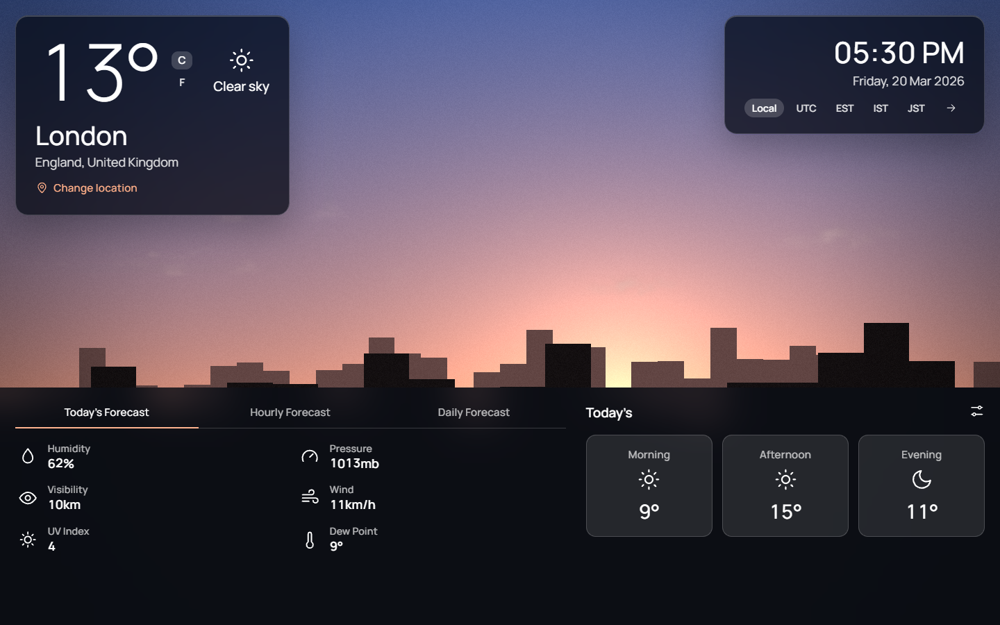
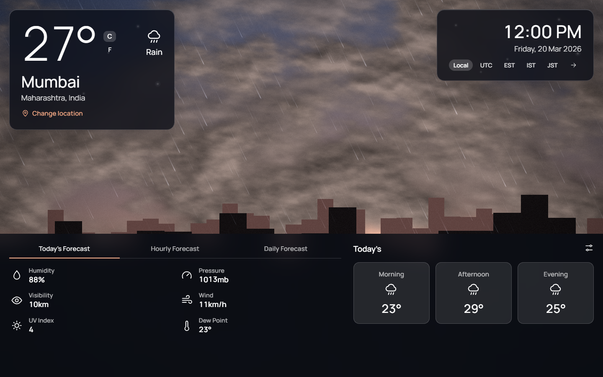
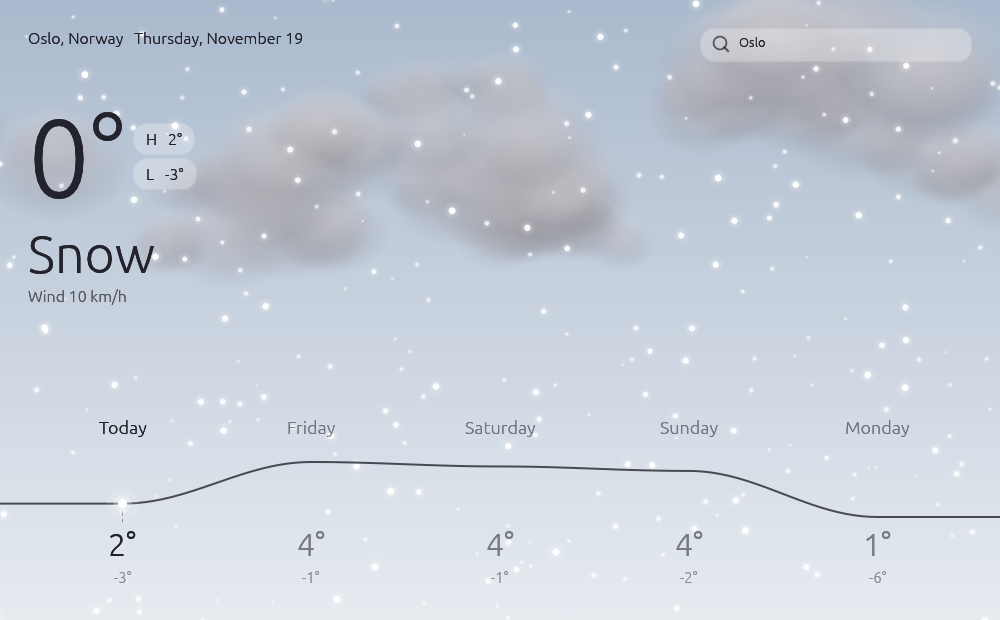
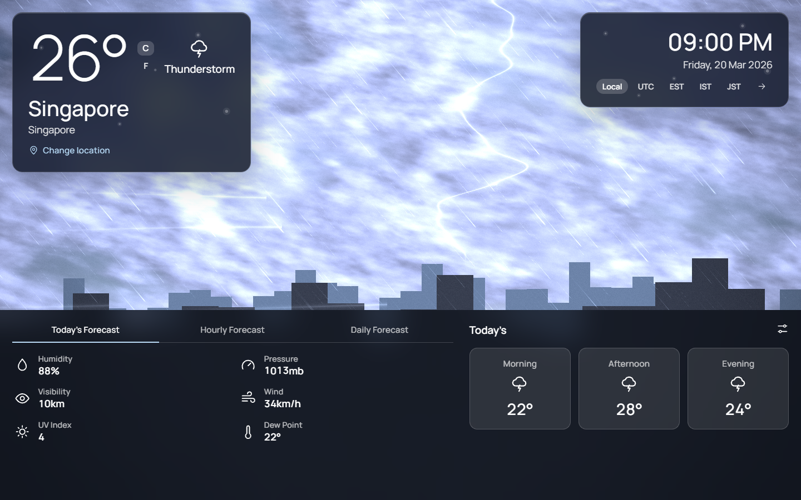
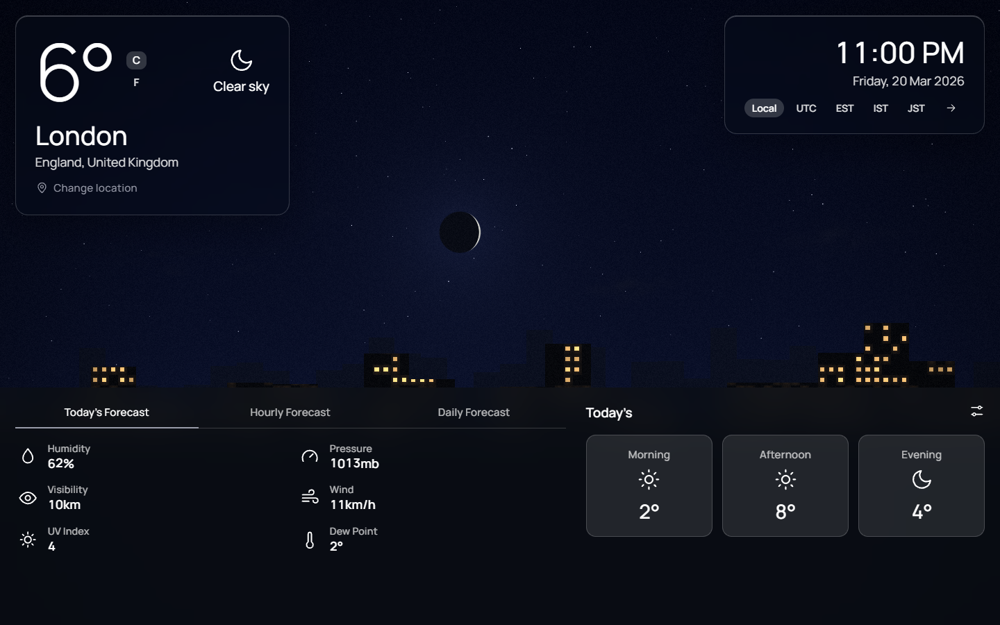

# Weather

A desktop weather app with a living sky: a real-time WebGL scene that follows the sun, the moon and the current conditions behind a calm, glassy interface.



| | |
|---|---|
|  |  |
|  |  |
|  |  |

> The screenshots are **seeded presets with mock data** (hand-set conditions for London, Mumbai, Reykjavik and Singapore), generated by `npm run screenshots`. They are not live forecasts.

## Features

- **Living sky.** Clear, cloudy, fog, rain, snow and thunderstorm skies, with the sun and moon placed by the time and the city's coordinates. Golden hour, night, stars, drifting clouds, falling rain and snow, and seeded lightning.
- **The data.** Current temperature and conditions, humidity, pressure, visibility, wind, UV index and dew point; a 48-hour timeline; a 5-day chart; morning, afternoon and evening cards; and a clock for the city plus UTC, EST, IST and JST.
- **Search.** `Ctrl+K` opens a palette with suggestions and your recent cities. Wrong names get a friendly error and the field shakes.
- **Settings.** °C/°F, km/h or mph, 12 or 24-hour clock, and quality (Auto, High, Battery). Auto steps the scene down on slow GPUs.
- **Motion and accessibility.** Motion can be Full, Reduced or Static (it also follows the system's reduced-motion setting). Dialogs trap focus, the page behind them is inert, and the interface has no serious axe violations in the tested states. Text colour adapts to the sky so it stays readable.

## Install (Windows)

1. Get `Weather_1.0.1_x64-setup.exe`. Build it yourself with the steps in [Run and build](#run-and-build); it is written to `target/release/bundle/nsis/`. No prebuilt download is published yet.
2. Run the installer. It installs for the current user, so it needs no administrator rights. If Windows SmartScreen warns about an unknown publisher, choose "More info", then "Run anyway" (the installer is unsigned).
3. Start **Weather** from the Start menu. Uninstall it from Windows Settings, Apps.

Silent install and uninstall, for scripts: `Weather_1.0.1_x64-setup.exe /S`, then `%LOCALAPPDATA%\Weather\uninstall.exe /S`. See [Install notes](#install-notes) for what an uninstall keeps.

## Stack

Tauri v2, Svelte 5, TypeScript, Vite, and a WebGL2 scene. The Rust side is a small library crate with the weather logic.

```
Svelte UI --invoke--> Tauri command --> weather_core --HTTPS--> Open-Meteo
```

| Path | What it is |
|---|---|
| `crates/weather_core` | Fetching, parsing, sky mapping, typed errors, 10 s request timeout. No UI. |
| `src-tauri` | The Tauri shell: three commands (`get_weather`, `get_weather_at`, `search_city`). |
| `ui` | The Svelte app, the WebGL scene, and all front-end and end-to-end tests. |
| `legacy-egui` | The original egui version (see [Legacy](#legacy)). |

## Prerequisites (Windows)

- [Rust](https://www.rust-lang.org/tools/install) and Node.js (LTS).
- The Tauri prerequisites for Windows: Microsoft C++ Build Tools and the WebView2 runtime. See the official [Tauri prerequisites](https://v2.tauri.app/start/prerequisites/).

`cargo-tauri` is **not** needed; the Tauri CLI runs through npm.

## Run and build

```sh
cd ui && npm install && cd ..
npm run tauri dev       # run from the repo root
npm run tauri build     # makes the NSIS installer
```

The installer is written to `target/release/bundle/nsis/Weather_1.0.1_x64-setup.exe`. Dev mode uses port 1420; if `tauri dev` says it is in use, stop whatever is listening there.

## Install notes

- The installers are **unsigned**, so Windows SmartScreen shows a warning. Choose "More info", then "Run anyway".
- Uninstalling keeps your saved city and settings in `%LOCALAPPDATA%\com.shivambhaskar.weather` unless you tick the delete-data box in the uninstaller.
- The app has no single-instance guard, so launching it twice opens two windows.

## Tests

```sh
cargo clippy --workspace --all-targets -- -D warnings
cargo test --workspace              # offline Rust tests
cargo test --workspace -- --ignored # also calls the live Open-Meteo API

cd ui
npm run check                       # svelte-check
npm test                            # Vitest
npm run build                       # also fails if a font is inlined as a data: URI
npx playwright install chromium     # once
npm run test:e2e:web                # Playwright: visual, keyboard, axe, flows (mocked invoke)
npm run test:e2e:tauri              # launches the real dev window, real IPC and network
npm run test:e2e:release            # same, against target/release/weather-app.exe (run `npm run tauri build` first)
```

The real-window projects start and stop the app themselves, so ports 1420 and 9222 must be free. They drive the actual WebView2 window with Playwright over the Chrome DevTools Protocol. To do that by hand, start the app with the debugging port open:

```sh
WEBVIEW2_ADDITIONAL_BROWSER_ARGUMENTS="--remote-debugging-port=9222" npm run tauri dev
```

In PowerShell: `$env:WEBVIEW2_ADDITIONAL_BROWSER_ARGUMENTS="--remote-debugging-port=9222"; npm.cmd run tauri dev` (`npm.cmd` avoids the script-execution policy that blocks `npm.ps1`).

Visual snapshots were made with software rendering (SwiftShader), allow 1% differing pixels, and live in `ui/e2e/web/__snapshots__`. Update them with `npx playwright test --project=web --update-snapshots`.

## Dev scene parameters

In dev builds (`npm run dev` in `ui`, or `tauri dev`), the URL can pin the scene so it is reproducible:

| Parameter | Meaning |
|---|---|
| `preset` | `Clear`, `Cloudy`, `Fog`, `Rain`, `Snow` or `Thunderstorm` (overrides live weather) |
| `time` | ISO moment for the sun and moon, e.g. `2026-03-20T17:30:00Z` |
| `seed` | Seed for particles and lightning |
| `at` | Scene clock in seconds, for one exact animation frame |
| `static` | Freeze motion |

Example: `http://localhost:1420/?preset=Thunderstorm&seed=1&at=9.24&static`. Dev builds also show **SceneLab**, a panel with a slider for each scene value. It is not in release builds.

Other scripts (from `ui`): `npm run screenshots` regenerates `docs/screenshots`, and `node scripts/icon.mjs` re-renders `assets/icon-1024.png` from `assets/icon.svg` (then `npm run tauri icon assets/icon-1024.png` from the root).

## Known limitations

- **Windows is the only verified platform.** macOS and Linux are untested, and there is no `.dmg` (macOS bundles can only be built on a Mac).
- CSS `@property` transitions may snap instead of animating on WebKit (macOS and Linux webviews).
- Not checked with a screen reader, on an integrated GPU, or on a high-DPI display.
- The dev window does not enforce the content security policy; the release build does.

## Data

Weather data by [Open-Meteo.com](https://open-meteo.com/), licensed [CC BY 4.0](https://creativecommons.org/licenses/by/4.0/). Open-Meteo's free API is for **non-commercial use** only.

## Legacy

`legacy-egui` is the first version, built with egui. It shares `weather_core`. Run it with `cargo run -p legacy-egui --release`.

## License

[MIT](LICENSE)
