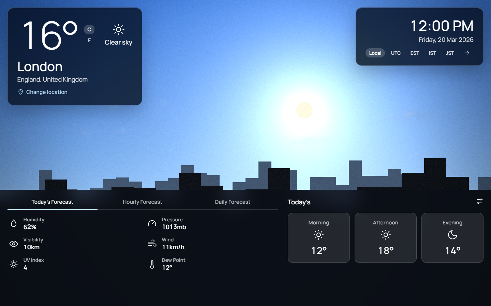

# WeatherApp

A desktop weather app written in Rust. Search for a city to see the current conditions and a 5-day forecast. The background is an animated sky that follows the live weather, changes between day and night, and reacts to the wind.

| Clear day | Rain |
|---|---|
|  |  |
| **Snow** | **Cloudy night** |
|  |  |

## Features

- Current temperature, today's high and low, the conditions and the wind speed.
- A 5-day forecast with weekday names, drawn on a smooth curve through the daily highs.
- An animated sky for each kind of weather:
  - clear skies get a sun by day and a moon with twinkling stars and the odd shooting star by night
  - soft clouds drift at different depths
  - rain falls in slanted drops and splashes at the bottom
  - snow flutters as it falls
  - fog drifts in banks
  - thunderstorms flash with lightning
  - wind above 25 km/h shows gust trails
- Text switches between dark and light so it stays readable on any sky.

## Run it

You need [Rust](https://www.rust-lang.org/tools/install), with Cargo.

```sh
git clone https://github.com/Shivam-cc/WeatherApp.git
cd WeatherApp
cargo run -p legacy-egui --release
```

Type a city into the search box and press Enter or click the magnifier.

## Tests

```sh
cargo test                 # offline unit tests
cargo test -- --ignored    # also calls the live weather service
```

## How it works

Everything is in [`src/main.rs`](src/main.rs).

- **Data:** [Open-Meteo](https://open-meteo.com/) turns the city name into coordinates, then provides the current weather and the daily forecast. It needs no API key.
- **UI:** [egui](https://github.com/emilk/egui) through `eframe`. The sky, clouds, rain and other effects are drawn with egui's painter every frame.
- **HTTP and JSON:** `ureq` and `serde_json`. Requests run on a background thread so the window stays responsive.

## Notes

- Open-Meteo's free tier is for non-commercial use.
- While weather is shown, the window redraws continuously to animate the sky, so it uses some CPU.
- The screenshots show four real cities, with the conditions set by hand so each kind of sky appears. Temperatures and forecasts are the real ones from when the screenshots were taken.

## License

[MIT](LICENSE)
